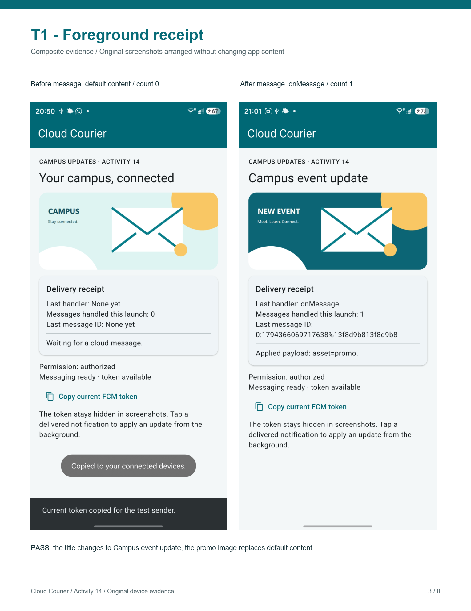
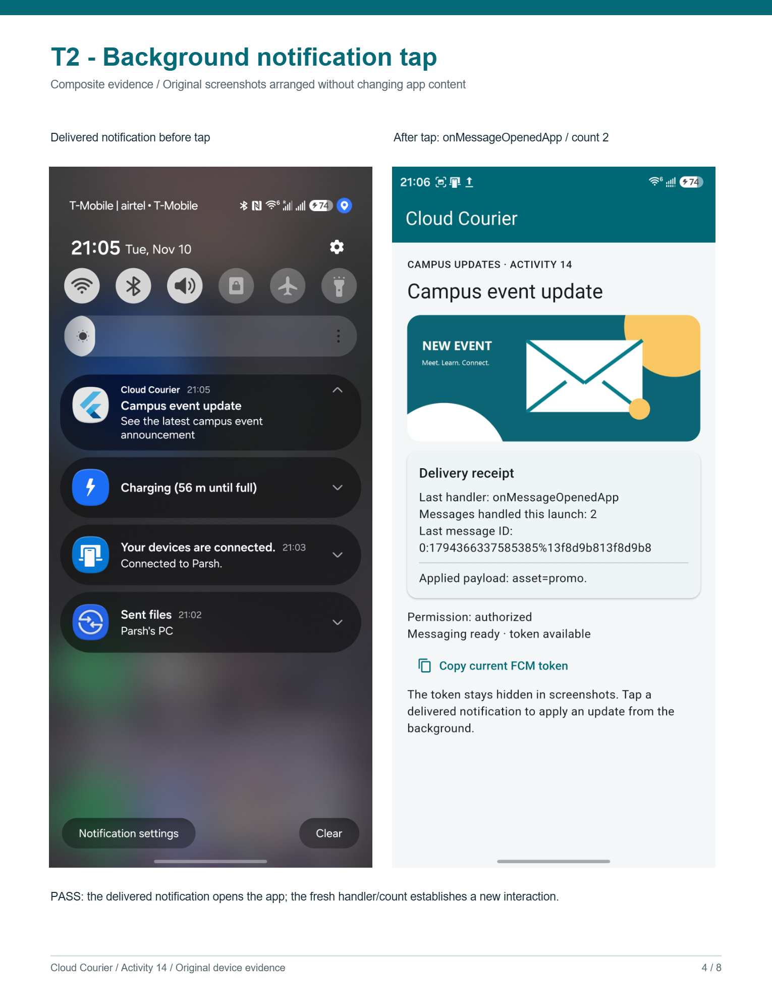
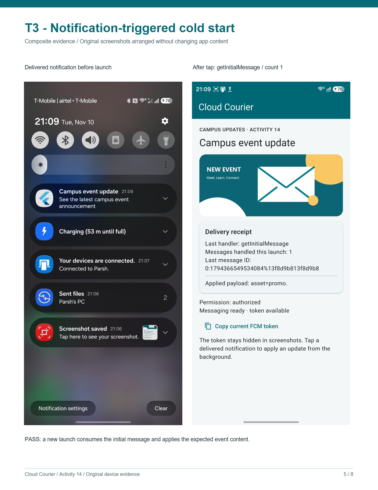
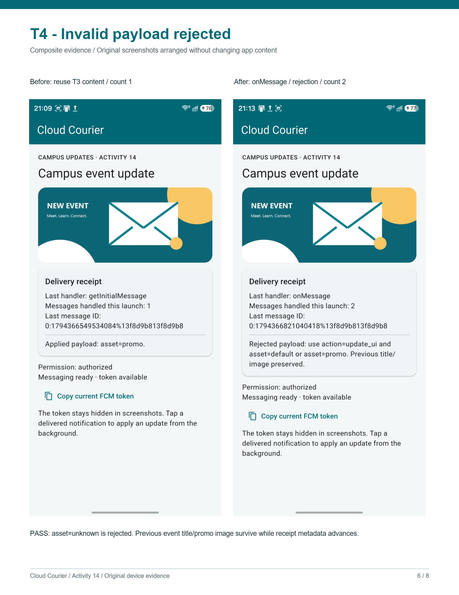

# In-Class Activity 14 — Cloud Courier

- **Student:** Parsh Jadon
- **Course:** CSC 4360, Mobile App Development
- **Repository:** https://github.com/parshjadon/MADinc14
- **Scenario:** Campus event announcements
- **Platform:** Android, package `com.parshjadon.cloud_courier`
- **Firebase project:** `temp-fc580`

**Upload document:** [Final submission PDF](output/pdf/Cloud_Courier_Submission.pdf).
The PDF includes the reflection, payload, four result rows, four labeled evidence
composites, and optional written answers. Original screenshot content is preserved;
the composites arrange screenshots for comparison without changing app content.

## Required reflection responses

### 1. Setup and payload

The app targets Android with a separately registered package and FlutterFire-generated
options to prevent project mismatches. Firebase initialization finishes before messaging
registration and widget startup. Core 4.x and Messaging 16.x retain the course's token
API. The string `action=update_ui` permits an update; `asset=default` or `asset=promo`
selects a bundled image. The notification title supplies the heading. An allowlist avoids
arbitrary asset paths. A token addresses an installation; delivery does not authorize
access to protected resources.

### 2. Lifecycle and evidence

`onMessage` handles foreground receipt, `onMessageOpenedApp` handles a background tap,
and `getInitialMessage()` handles a notification-triggered cold start. Android executes
the separate `onBackgroundMessage` callback in another isolate, preventing direct widget
updates. T1 shows `onMessage`, count 1, and promo content; T2 shows the notification
followed by `onMessageOpenedApp`, count 2; T3 shows `getInitialMessage`, count 1, and
expected content on a new launch. These notification-plus-data results do not establish
data-only reliability. Android force-stop blocks delivery until reopening; one phone
cannot establish universal platform behavior.

### 3. Validation and next step

T4 changes `asset` to `unknown`: its screenshot shows rejection, `onMessage`, and count
2 while preserving T3's title/image. Lifetime guards prevent callbacks from changing
disposed widgets; disposal cancels listeners. Repeated content is harmless here, but
business operations would benefit from event-ID deduplication: sending the same ID
twice should produce one operation. AI assisted the code, automated tests, and writing;
the student supplied T1-T4 device screenshots.

## Device, permission, and payload record

- **Available environment:** Windows host; Flutter 3.47.2; Dart 3.13.2.
- **Device/OS:** Samsung SM-S938U1, Android 17, read from the connected device through
  ADB. The student's screenshots show the app running on the phone.
- **Permission status:** `authorized`, visible in both T1 screenshots.
- **Device token:** The app reports a token is available; the before screenshot shows
  the copy action succeeded. The full token is hidden and is not included here.
- **Valid payload:** notification plus custom string data, as shown below.
- **T4 change:** Replace only `data.asset` with the string `unknown`.

```json
{
  "notification": {
    "title": "Campus event update",
    "body": "See the latest campus event announcement"
  },
  "data": {
    "action": "update_ui",
    "asset": "promo"
  }
}
```

This is message content, not a complete HTTP v1 request. A trusted sender must add the
target installation token and the required request envelope. Server credentials must
remain outside the Flutter application.

## Four required result rows

| Test | Expected handler/result | Observed result | Status | Evidence |
| --- | --- | --- | --- | --- |
| T1 — foreground | `onMessage`; title becomes Campus event update, promo image appears, receipt count advances | Before: default title/image, no handler, count 0. After: `onMessage`, count 1, Campus event update, promo image, and Applied payload: asset=promo | Pass | [T1 before/after composite](evidence/T1-composite.png) |
| T2 — background tap | Delivered notification is tapped; `onMessageOpenedApp`; fresh receipt and expected UI | Cloud Courier notification appears at 21:05. After opening: `onMessageOpenedApp`, count 2, fresh message ID, Campus event update, promo image, and Applied payload: asset=promo | Pass | [T2 notification/open composite](evidence/T2-composite.png) |
| T3 — cold-start tap | Notification launches terminated app; `getInitialMessage`; count 1 and expected UI | Notification delivered at 21:09; opened app shows `getInitialMessage`, count 1 on the new launch, fresh message ID, Campus event update, promo image, and Applied payload: asset=promo | Pass | [T3 notification/cold-start composite](evidence/T3-composite.png) |
| T4 — unsupported asset | `onMessage`; rejection diagnostic; count advances; previous title/image preserved; no crash | `onMessage`, count 2, fresh message ID, visible rejection diagnostic, and the same Campus event update title/promo image as T3; app remains on screen without a crash | Pass | [T4 preserved-content comparison](evidence/T4-composite.png) |

## T1 device evidence

Left: initial content and receipt count 0. Right: foreground receipt with count 1 and
the resulting title/image. Permission is `authorized` in both original screenshots.



## T2 device evidence

The notification screenshot shows the Cloud Courier title/body before the tap. The
subsequent app screenshot shows `onMessageOpenedApp`, receipt count 2, a fresh message
ID, and the expected campus event content. Reusing the valid payload leaves the title
and image unchanged; the new handler/count establishes a fresh interaction.



## T3 device evidence

The notification screenshot precedes the app screenshot displaying
`getInitialMessage`, receipt count 1, and a new message ID. The campus event title
and promo image are applied on the new launch. This distinguishes the cold-start
notification-open path from T2's background-open listener.



## T4 device evidence

T3's app screenshot is reused as the before state: title Campus event update, promo
image, count 1. After sending `action=update_ui` with `asset=unknown` while foregrounded,
T4 shows `onMessage`, count 2, a fresh message ID, and the rejection diagnostic. The
previous title and image are preserved, and the app remains on screen without a crash.



## Checks actually performed

- FlutterFire registered/configured the Android app against the stated project.
- `flutter pub get` succeeded with Firebase Core 4.15.2 and Messaging 16.7.1.
- `flutter analyze` completed with no issues.
- `flutter build apk --debug` succeeded and produced the Android debug APK. Build
  output stays outside Git; compiling does not establish device launch or FCM delivery.
- `flutter test` passed all three automated tests. They cover repeated valid receipts,
  all three UI callback labels, missing/unsupported/malformed assets and unsupported
  actions preserving prior content, initial-message application, hidden tokens, and
  safe callbacks after disposal.

The automated tests use a fake messaging service and do not substitute for T1–T4.
T1-T4 now have real device evidence, and Android permission is visibly authorized.
Results apply to the recorded Samsung/Android target and notification-plus-data payload;
no second-platform or data-only background-delivery result is claimed. This document
and repository do not establish an LMS upload.

## Practice Arena answers

1. Foreground receipt uses `FirebaseMessaging.onMessage`.
2. Check `getInitialMessage()` after Firebase initialization for a notification-triggered
   launch from termination.
3. Reject unknown assets against the allowlist, explain the diagnostic, and preserve safe UI.
4. Strong background evidence connects the payload, actual notification tap, matching
   handler/count, and expected visible result.

## Implementation knowledge-check answers

1. The background callback is top-level so the plugin can invoke it without a widget
   instance; Android background execution uses a separate isolate. The entry-point
   annotation keeps it available in optimized builds.
2. `getInitialMessage()` checks whether a notification tap launched a terminated app.
3. Change a simple label or image from the validated payload before adding complexity.
4. A reinstall may change the token; retrieve the current token before the next send.

## Optional reasoning answers

- **Token Tracker:** Tokens identify current app installations and can rotate. Using an
  old token can target a removed installation. The service observes token refresh.
- **State Mapper:** Visible app → receipt → `onMessage` → validated widget update.
  Background app → delivered notification → tap → `onMessageOpenedApp` → widget update.
  Terminated app → delivered notification → tap/launch → `getInitialMessage()` → widget
  update. Separately delivered background work → top-level `onBackgroundMessage` →
  bounded non-UI processing; it is not a notification-open event.
- **Payload Validator:** T4's device result and its comparison with T3 demonstrate
  rejection and preservation. Automated tests also cover missing/malformed assets.
- **Evidence Builder:** The JSON and four rows above define reproducible device checks.
  A send confirmation or build success alone would not prove receipt or a UI reaction.
- **Design Critic:** The claim that every background notification immediately changes
  widgets is incorrect. Firebase distinguishes background work from notification-open
  handling. T2's notification and `onMessageOpenedApp` screenshots support the
  background-tap path. T3 separately shows the cold-start `getInitialMessage` result.
  See [Firebase's message-handling guide](https://firebase.google.com/docs/cloud-messaging/flutter/receive-messages).
- **Repeat-send trade-off:** Reapplying the same content is harmless in this sample;
  receipt metadata still advances. A production workflow with side effects should use
  an application event ID and durable deduplication, tested by sending the same event
  twice and observing exactly one business operation.
- **Optional payload detail:** Both required custom values are strings. Unsupported
  actions, missing assets, unknown asset names, and non-string asset values are rejected.
  The notification body is informational; the two data keys determine the UI action.
- **Optional improvement detail:** With all four device results recorded, add event-ID
  deduplication if repeated notifications trigger business operations. Measure success
  through one operation for repeated IDs and separate operations for distinct IDs.

**Assistance disclosure:** Codex generated the code, original geometric image assets,
automated tests, and these written answers from the supplied assignment. Review and
disclose that assistance according to the course's policy.
