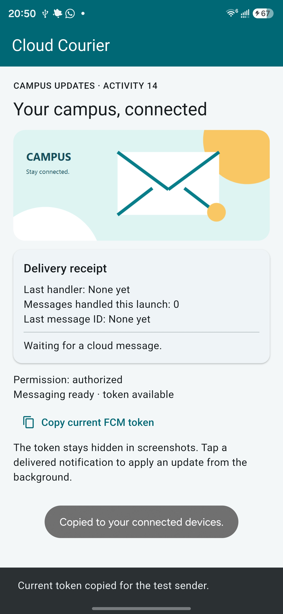
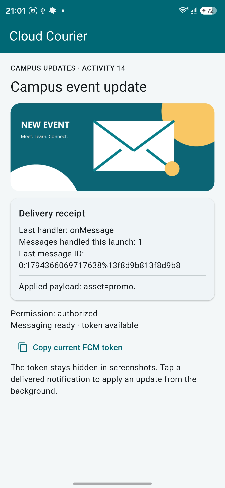

# In-Class Activity 14 — Cloud Courier

- **Student:** Parsh Jadon
- **Course:** CSC 4360, Mobile App Development
- **Repository:** https://github.com/parshjadon/MADinc14
- **Scenario:** Campus event announcements
- **Platform:** Android, package `com.parshjadon.cloud_courier`
- **Firebase project:** `temp-fc580`

## Required reflection responses

### 1. Setup and payload

The implementation targets Android only, using a separately registered package and
FlutterFire-generated options to avoid a project/app mismatch. Firebase initialization
finishes before messaging registration and widget startup. Core 4.x and Messaging 16.x
retain the course's registration-token API. The string `action=update_ui` permits a
content update; `asset=default` or `asset=promo` selects one of two bundled images.
The notification title supplies the heading. An allowlist is simpler and safer than
constructing an arbitrary asset path. A token addresses an installation; neither the
token nor successful message delivery grants authorization to protected resources.

### 2. Lifecycle and evidence

`onMessage` handles foreground receipt, `onMessageOpenedApp` handles a background
notification tap, and `getInitialMessage()` handles a notification-triggered cold start.
The separate `onBackgroundMessage` callback performs non-UI work; Android runs it in
another isolate, so it cannot update foreground widget state. Automated callback tests
verify UI behavior. The linked T1 before/after screenshots show `onMessage`, count 1,
and the promo image replacing default content. T2–T4 still await device evidence.
Android force-stop prevents delivery until reopening; one device's results cannot
establish universal platform reliability.

### 3. Validation and next step

T4 uses `asset=unknown`. Automated checks observe a rejection diagnostic while the
previous title/image survive and receipt metadata advances. Lifetime guards prevent
late callbacks from changing disposed widgets; service disposal cancels listeners.
The next step is recording T2–T4 on the connected phone, including T4's before/after
comparison. AI assisted the implementation, automated tests, and written responses;
the student supplied the T1 device screenshots.

## Device, permission, and payload record

- **Available environment:** Windows host; Flutter 3.47.2; Dart 3.13.2.
- **Device/OS:** Samsung SM-S938U1, Android 17, read from the connected device through
  ADB. The student's screenshots show the app running on the phone.
- **Permission status:** `authorized`, visible in both T1 screenshots.
- **Device token:** The app reports a token is available; the before screenshot shows
  the copy action succeeded. The full token is hidden and is not included here.
- **Valid payload:** notification plus custom string data, as shown below.
- **T4 change:** Replace only `data.asset` with the string `unknown`.

```json
{
  "notification": {
    "title": "Campus event update",
    "body": "See the latest campus event announcement"
  },
  "data": {
    "action": "update_ui",
    "asset": "promo"
  }
}
```

This is message content, not a complete HTTP v1 request. A trusted sender must add the
target installation token and the required request envelope. Server credentials must
remain outside the Flutter application.

## Four required result rows

| Test | Expected handler/result | Observed result | Status | Evidence |
| --- | --- | --- | --- | --- |
| T1 — foreground | `onMessage`; title becomes Campus event update, promo image appears, receipt count advances | Before: default title/image, no handler, count 0. After: `onMessage`, count 1, Campus event update, promo image, and Applied payload: asset=promo | Pass | [Before](evidence/T1-before.jpg), [foreground result](evidence/T1-foreground.jpg) |
| T2 — background tap | Delivered notification is tapped; `onMessageOpenedApp`; fresh receipt and expected UI | No device screenshot/recording supplied for this path yet | Pending evidence | Not supplied |
| T3 — cold-start tap | Notification launches terminated app; `getInitialMessage`; count 1 and expected UI | No device screenshot/recording supplied for this path yet | Pending evidence | Not supplied |
| T4 — unsupported asset | `onMessage`; rejection diagnostic; count advances; previous title/image preserved; no crash | Callback/UI test passed with `asset=unknown`; real device rejection has not yet been evidenced | Pending device evidence | [Automated validation test](test/message_handling_test.dart); device evidence not supplied |

## T1 device evidence

The original student-supplied screenshots are preserved without image edits. The first
shows the initial content and receipt count 0. The second shows the foreground receipt
with count 1 and the resulting title/image. Permission is `authorized` in both.

**Before the message**



**After the foreground message**



## Checks actually performed

- FlutterFire registered/configured the Android app against the stated project.
- `flutter pub get` succeeded with Firebase Core 4.15.2 and Messaging 16.7.1.
- `flutter analyze` completed with no issues.
- `flutter build apk --debug` succeeded and produced the Android debug APK. Build
  output stays outside Git; compiling does not establish device launch or FCM delivery.
- `flutter test` passed all three automated tests. They cover repeated valid receipts,
  all three UI callback labels, missing/unsupported/malformed assets and unsupported
  actions preserving prior content, initial-message application, hidden tokens, and
  safe callbacks after disposal.

The automated tests use a fake messaging service and do not substitute for T1–T4.
T1 now has real device evidence, and Android permission is visibly authorized. T2–T4
device evidence remains missing. This document and repository do not establish an
LMS upload or completion of every required device test.

## Practice Arena answers

1. Foreground receipt uses `FirebaseMessaging.onMessage`.
2. Check `getInitialMessage()` after Firebase initialization for a notification-triggered
   launch from termination.
3. Reject unknown assets against the allowlist, explain the diagnostic, and preserve safe UI.
4. Strong background evidence connects the payload, actual notification tap, matching
   handler/count, and expected visible result.

## Implementation knowledge-check answers

1. The background callback is top-level so the plugin can invoke it without a widget
   instance; Android background execution uses a separate isolate. The entry-point
   annotation keeps it available in optimized builds.
2. `getInitialMessage()` checks whether a notification tap launched a terminated app.
3. Change a simple label or image from the validated payload before adding complexity.
4. A reinstall may change the token; retrieve the current token before the next send.

## Optional reasoning answers

- **Token Tracker:** Tokens identify current app installations and can rotate. Using an
  old token can target a removed installation. The service observes token refresh.
- **State Mapper:** Visible app → receipt → `onMessage` → validated widget update.
  Background app → delivered notification → tap → `onMessageOpenedApp` → widget update.
  Terminated app → delivered notification → tap/launch → `getInitialMessage()` → widget
  update. Separately delivered background work → top-level `onBackgroundMessage` →
  bounded non-UI processing; it is not a notification-open event.
- **Payload Validator:** The automated unsupported-asset case demonstrates rejection
  and preservation; the required device demonstration is still unavailable.
- **Evidence Builder:** The JSON and four rows above define reproducible device checks.
  A send confirmation or build success alone would not prove receipt or a UI reaction.
- **Design Critic:** The claim that every background notification immediately changes
  widgets is incorrect. Firebase distinguishes background work from notification-open
  handling. Automated callbacks support the UI-side distinction; background delivery
  and notification taps are not yet evidenced. See [Firebase's message-handling guide](https://firebase.google.com/docs/cloud-messaging/flutter/receive-messages).
- **Repeat-send trade-off:** Reapplying the same content is harmless in this sample;
  receipt metadata still advances. A production workflow with side effects should use
  an application event ID and durable deduplication, tested by sending the same event
  twice and observing exactly one business operation.
- **Optional payload detail:** Both required custom values are strings. Unsupported
  actions, missing assets, unknown asset names, and non-string asset values are rejected.
  The notification body is informational; the two data keys determine the UI action.
- **Optional improvement detail:** After collecting the four device results, add event-ID
  deduplication if repeated notifications trigger business operations. Measure success
  through one operation for repeated IDs and separate operations for distinct IDs.

**Assistance disclosure:** Codex generated the code, original geometric image assets,
automated tests, and these written answers from the supplied assignment. Review and
disclose that assistance according to the course's policy.
